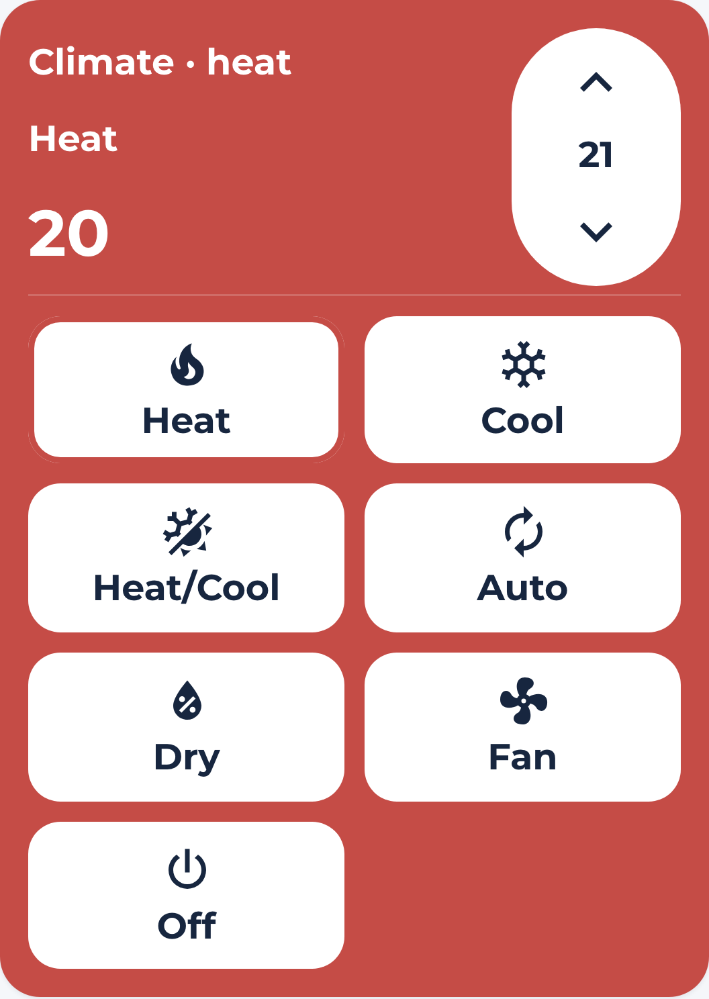

# Climate Card

The `hc_climate_card` shows a large, unitless current temperature and a target
temperature stepper. Its background identifies the active HVAC mode; `off`,
`unknown`, and `unavailable` retain the neutral card background. When multiple
HVAC modes are available, the mode buttons use representative icons and labels.



## Usage

```yaml
  - type: custom:marao-card
    template: hc_climate_card
    entity: <climate entity>
```
## Variables

| Variable | Default | Required | Description|
|----------|---------|----------|------------|
| show_mode_buttons | true in generated mode sheets | Show mode buttons on this card. |
| mode_selector_hash | Empty | Open the configured mode popup from the card. |
| setpoint_label | Localized target temperature | Accessible name for the target stepper. |
| show_graph | false | Show a temperature history graph behind the card. |
| graph_entity | Empty | Sensor entity supplying the graph. |
| graph_color | Theme text/accent color | Graph line and fill color. |

## State colors

| HVAC mode | Theme color |
|------------|-------------|
| Heat / heating | `--color-red` |
| Cool / cooling | `--color-blue` |
| Heat/Cool | `--color-purple` |
| Auto | `--color-gold` |
| Dry / drying | `--color-yellow` |
| Fan only | `--color-green` |

## Contribution
- [ptC7H12](https://github.com/ptC7H12)
