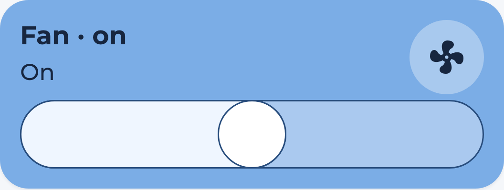

# Fan Card

`hc_fan_card` toggles a fan and shows a speed slider when the entity supports
speed control. Single-speed fans have only the toggle. Unknown and unavailable
entities keep their controls disabled.



```yaml
- type: custom:marao-card
  template: hc_fan_card
  entity: fan.living_room
  variables:
    enable_slider: true
```

| Variable | Default | Description |
|----------|---------|-------------|
| enable_slider | true | Show the slider on fans that support speed control. |
| card_color | var(--color-blue) | Active card color. |
| custom_label | Empty | Prefix for the displayed state. |
