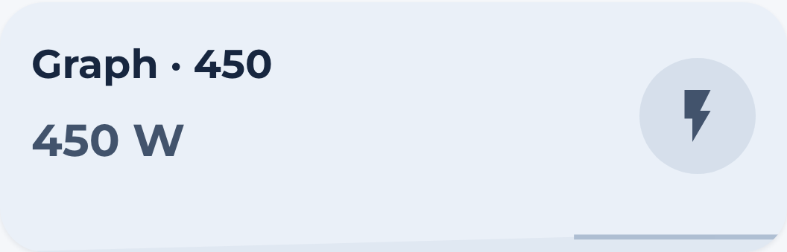

# Graph Card

`hc_graph_card` shows a sensor's live numeric reading over Marao's own
24-hour background trace. The trace reads Home Assistant recorder history once
for the card, appends the current state, and needs no native history-graph card
or other frontend resource. If no numeric history is available, the current
reading remains visible and the background stays neutral.
Temporary Home Assistant shell moves retain the same card’s pending request and settled history, including failures. Results finishing after removal are discarded; source and connection changes still invalidate history.

Loading and empty history have readable status text. A failed history request
shows `History unavailable` while preserving the current reading. Unknown,
unavailable, and disconnected graph sources stay neutral; history loads again
after the source recovers.



Reported media or history failures affect the whole card and keep a readable reason. Use the visible Retry or Refresh control to try again; event details also keep Back. Useful readings and actions with available targets remain usable. A failed actual control target shows a partial warning and disables that action. Problem surfaces take priority over artwork and custom colors.

## Usage

```yaml
  - type: custom:marao-card
    template: hc_graph_card
    entity: <sensor entity>
    variables:
      graph_color: <desired color>
```

## Variables

| Variable | Default | Required | Description |
|----------|---------|----------|------------|
| graph_color | Theme card text/accent color | No | Color for the graph line and fill. |
| graph_background | Transparent | No | Optional tint behind the graph, without replacing the card's state background. |
| show_graph_line | true | No | Show the graph line. |
| show_graph_fill | true | No | Show the graph fill. |
| show_icon | false | No | Show the card icon. |

## Numeric reading format

Set `variables.display_unit` to convert a compatible power/energy reading and
`variables.display_precision` to an integer from 0 to 6. Omit either key for Auto.
For example, a W sensor with `display_unit: kW` and `display_precision: 2` shows
1500 W as `1.50 kW` (punctuation follows Home Assistant). See the
[shared energy format contract](index.md#energy-reading-format) for unit choices,
raw history handling and incompatible metadata. Nonnumeric states keep their
normal presentation.
