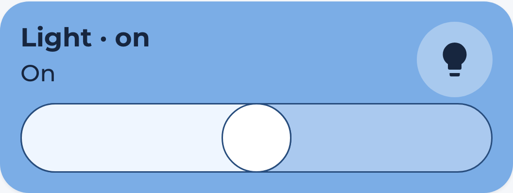

# Light Card

Generated overview lighting popups list every configured light, including lights
that are off. Unknown and unavailable lights remain visible with disabled controls.
The `hc_light_card` is used to turn on and off a light. You have the option to show or hide the brightness slider.




## Usage

```yaml
  - type: custom:marao-card
    template: hc_light_card
    entity: <your light entity>
    name: MyLight
    variables:
        enable_slider: true
```
**Remember to take care of indentation**
## Variable / entry

| Variable | Default | Required | Example|
|:----------|:---------|:----------|:------------|
| <span class="entry-type-ha"></span> entity | | **Yes** | light.livingroom |
| <span class="entry-type-ha"></span> name | friendly name | No | Livingroom Light |
| <span class="entry-type-marao_dashboard"></span> enable_slider | true | No | Show or hide the brightness slider|
| <span class="entry-type-marao_dashboard"></span> card_color | var(--color-blue) | No | The active card color |

## Brightness

The slider uses the entity's supported color modes to detect dimming support.
On/off-only lights have a toggle without a slider. Set `enable_slider: false` to
hide it on dimmable lights. `custom_label` adds a prefix to the displayed state.
