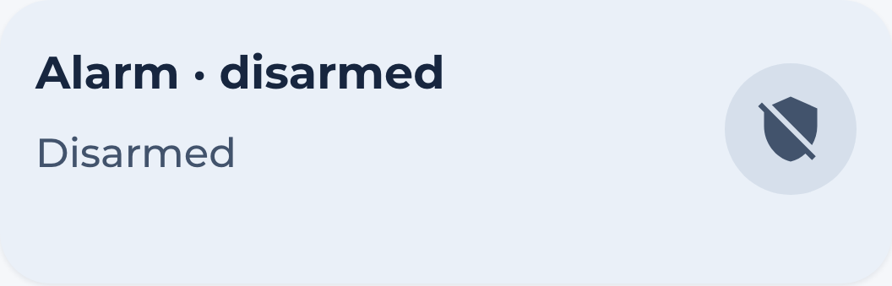

# Security Card

The `hc_security_card` shows Home Assistant's alarm state and opens a Marao sheet
with the arming modes supported by your panel. Ordinary arming uses an explicit
tap. Disarming and arming with bypass require a 1.2-second hold with visible
border progress. Releasing early or moving outside cancels the action.




## Usage

```yaml
  - type: custom:marao-card
    template: hc_security_card
    entity: <your_alarm_entity>
```

## Variables

| Variable | Default | Required | Description|
|----------|---------|----------|------------|
| popup_hash | Generated | No | Sheet identity; generated dashboards assign one per card. |
| icon_color | var(--color-blue) | No | Color of the icon |

Generated dashboards create the alarm sheet automatically. For manual YAML,
add a Marao popup at the same hash containing a `custom:marao-card` with template
`hc_alarm_controls_card` and the alarm entity.

When Home Assistant requires a code, the sheet uses a masked numeric or text
field. The code remains only in memory and clears after an attempt, closing,
target replacement or disconnection. Do not put alarm codes in dashboard JSON
or YAML. Existing unknown options survive editing but are not PIN storage.
Service acknowledgement does not change the displayed alarm state. Rejections
show a readable error with submitted codes redacted; retry requires another
explicit interaction. Unavailable, unknown, missing and disconnected panels
disable controls.
