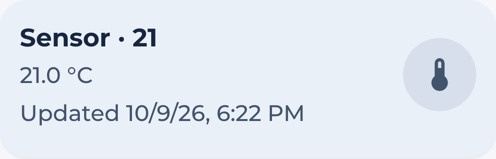

# Sensor Card

The `hc_sensor_card` is used to view the state of a sensor or binary sensor. It's configured to show the state of the sensor and the last updated time when Home Assistant supplies it.



## Usage

```yaml
  - type: custom:marao-card
    template: hc_sensor_card
    entity: <sensor or binary sensor>
```

## Variables

| Variable | Default | Required | Description|
|----------|---------|----------|------------|
| hc_card_color | var(--primary-color) | No | Active background color. |
| on_icon | Entity icon | No | Icon for on or non-binary states. |
| off_icon | Entity icon | No | Icon for off states. |
