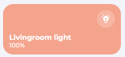
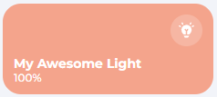
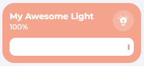

# Usage
Use [native Home Assistant cards](native-cards.md) to add, configure, duplicate
and resize Marao cards directly in Home Assistant's dashboard editor. Named
cards retain specialized options and own their automatic detail sheets.

The [editable page card guide](editable-page-cards.md) covers weather, room,
scenes, alarm/service actions, period readings, media apps and shared page
descriptor options retained by the native card editor.
Use [Entity Group](md_entity_group_card.md) for explicit task summaries and member
control sheets on Overview, room or custom pages.

We made Marao Dashboard easy to use but you need to know a few basics. 
{: .fs-6 .fw-300 }

## Variables and entries
All of the cards are using the default entries from Home Assistant and variables set in the template cards from Marao Dashboard. Almost most of the cards require at least one of them and sometimes both.

For example, the light cards requires you to add a `light entity` which you can enter through the `entity:` entry.

```yaml
  - type: custom:marao-card
    template: md_light_card
    entity: light.livingroom
```


It is also possible to change the name of the light by giving the `name:` entry, like so:

```yaml
  - type: custom:marao-card
    template: md_light_card
    entity: light.livingroom
    name: My Awesome Light
```


With variables, you can change certain aspects in the card, eg. enabling the slider

```yaml
  - type: custom:marao-card
    template: md_light_card
    entity: light.livingroom
    name: My Awesome Light
    variables:
      enable_slider: true
```


Every card you will see on this documentation page have all the needed and optional variables described. Based on round color, you can see if its a Home Assistant default Entry or a variable from Marao Dashboard.

**Legend:** <span class="entry-type-ha"></span> Home Assistant Entry - <span class="entry-type-marao_dashboard"></span> Marao Dashboard variable

## Included templates

Marao Dashboard includes project-owned templates for more specific devices and
workflows. These are documented in this cards section:

- `md_cover_card`
- `md_camera_card`
- `md_battery_card`
- `md_dishwasher_card`
- `md_number_card`
- `md_toggle_graph_card`
- `md_vacuum_card`
- [`md_room_card`](md_room_card.md)
- `md_washing_machine_card`

Normal binary state words are omitted across Marao cards, including raw cards with `show_state: true`. Backgrounds and visible state markers communicate the current state, with localized accessible names. Useful values, labels, action names, transitions and historical interval labels remain.

Unknown, unavailable, missing and disconnected entities use a neutral whole-card surface with a localized reason. Recognized faults and reported action/content errors use an alert surface; individual-card availability cues use concise localized status text without repeating entity names. Partially available group/room summaries keep their usable counts and normal palette without unavailable counts or member-warning rows; their sheets still show individual member status. Other partial cards keep useful content and safe actions with a concise availability cue. Problem reasons remain visible with `show_state: false` or hidden icons. A later successful explicit action retry clears its reported error without replacing Home Assistant’s authoritative state.

## Energy reading format

Energy detail sheets keep their day/month label and period arrows pinned below
the popup title while scrolling, and show vertical bars of
consumption or cost: hourly for a day, daily for a month. Tap a bar or use
the navigation arrows to inspect its interval and exact formatted value. In a
monthly sheet, selecting a day replaces the total row with the date followed by
its value, keeping the chart in place, and focuses the circular breakdown and
contributor values on that day. Use **Full month** beside the day navigation to clear the
selection and restore the monthly overview in both charts. Calendar
boundaries follow Home Assistant's time zone, including daylight-saving days.
Sheets preload four nearby periods in each direction (months or days), excluding
future dates, so cached navigation is immediate. The current period refreshes
on return if its cached data is over a minute old.
Totals use Recorder statistics or supported counter changes; gaps remain empty
and partial totals retain the approximation marker without extra coverage labels.
Configured appliance/room energy and cost
sensors appear beneath the chart, with a circular comparison beside the legend.
They stack using the same width and text-size rule as two-column cards. See
[energy breakdown and prices](../../installation/configuration.md#energy-display-choices)
for configuration and estimated costs. Inspecting history does not operate the
entity. Other numeric cards retain their [recorded-reading chart](md_graph_card.md#inspect-history).

Graph and toggle-graph cards, numeric sensor/base readings, switch secondary power
and Energy period summaries/sheets accept two opt-in display settings:

| Setting | Auto (omitted) | Explicit value |
| --- | --- | --- |
| `display_unit` | Actual source unit | Compatible unit from the table below; converts the value. |
| `display_precision` | Trim trailing zeros, at most six decimal places | Integer 0–6; exactly that many decimal places. |

For shared cards, put these settings under `variables`. Direct
`custom:marao-energy-period-card` configurations put them at card level.
Energy card descriptors put them under `variables`; generation carries the
same settings into the summary and its sheet. Use the shared unit/decimal
controls in the card editor. Auto removes
only that setting. Copies of a reading can use different settings.

| Dimension | Supported units |
| --- | --- |
| Power | `mW`, `W`, `kW`, `MW`, `GW` |
| Energy | `Wh`, `kWh`, `MWh`, `GWh`, `J`, `Ws`, `kJ`, `MJ`, `GJ` |

Unit identifiers are case-sensitive: `mW` is a milliwatt and `MW` a megawatt.
3600 J = 1 Wh. Power and energy cannot be interchanged. Precision alone can
format a cost while keeping its original currency; there is no currency exchange.
Numbers use Home Assistant's selected number format, with its language or the
browser language as fallback. Real zero and signed export values remain valid;
rounding hides negative-zero text.

With both settings omitted, existing primary displays remain unchanged. On switches,
legacy `power_unit` is a label only. Enabling either new setting uses the actual
secondary sensor's unit; an explicit compatible `display_unit` converts from it.
It never formats the primary on/off state or changes Home Assistant state,
service values, climate values, or control inputs.

The editor and generator validate precision and actual live source metadata
before saving/generating. If source metadata later becomes incompatible, the card
keeps the original readable live value/unit and reports a localized format error.
It never applies a converted label to an unconverted value.

Numeric energy history retains each raw record and its original unit in the
existing bounded request/cache. Compatible records are converted without rounding
before bounds and geometry are calculated, including in Auto: history uses the
current source unit unless a compatible display unit is selected. For example,
3600 J in an earlier record becomes 1 Wh when the current source reports Wh.
Changing precision changes the labels without changing those normalized values.
Detail readings, bounds and summaries use the same unit. Only visible labels are rounded.
Past `unknown`, `unavailable` and other nonnumeric states are omitted from numeric
conversion, without becoming zero or invalidating usable readings. Missing or
incompatible units on numeric historical readings remain gaps with a readable
format error instead of an unconverted number under another unit. Compatible
records remain available. A separately selected graph sensor uses its own
metadata. Changing only format settings reuses raw history and keeps the selected
period. Source or period changes invalidate obsolete requests.

Strict access open/unlock sliders use a rounded track and round arrow handle,
without a progressing background fill. Drag from anywhere on the handle,
including its edges; the label fades during travel and returns on reset. Track
taps, incomplete slides and scrolling gestures never execute the access action.

Lock, door, gate and garage popups show the authoritative entity state and its
matching icon once in the header. Their action cards omit repeated state. Unlock/open shows only a slider beside
a decorative action icon on the left; close/lock shows its left action icon and
a larger label centered across the tap surface. The header follows the base-card
spacing, with a circular state icon on the left, left-aligned title/state text and
vertically centered header controls.
It grows with wrapped text instead of shrinking its title or state. Sending
feedback and reported service errors remain attached to the action.

## Access slide feedback

Completing a valid door, gate or lock opening slide requests a strong vibration
and pulses the slider blue. A gentle blue shimmer indicates the command is being
sent. Home Assistant's acceptance shows a checkmark and **Request sent** for about
one second before returning to the reported device state. Acceptance does not
prove the physical access point moved. Errors and unavailable states take priority;
there are no automatic retries. Reduced-motion clients use static color and icons.
Physical vibration depends on client support; visual feedback remains available.
